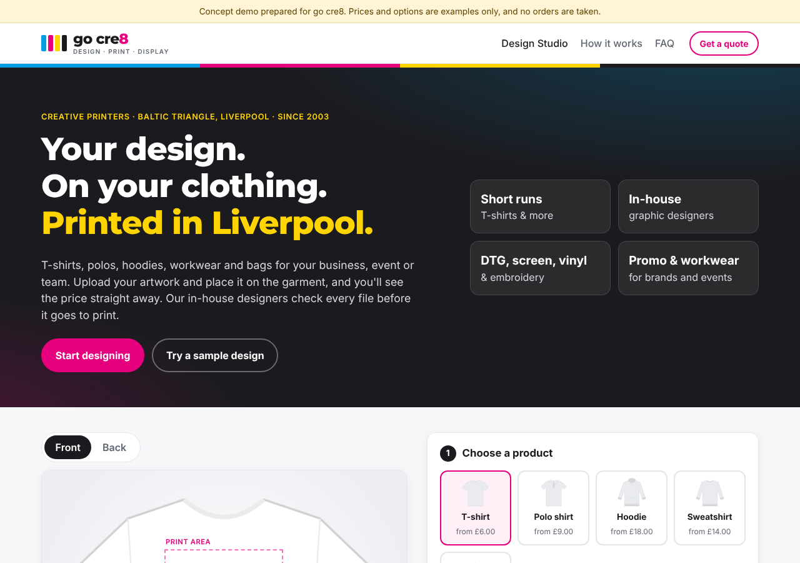
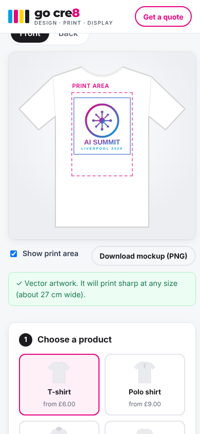
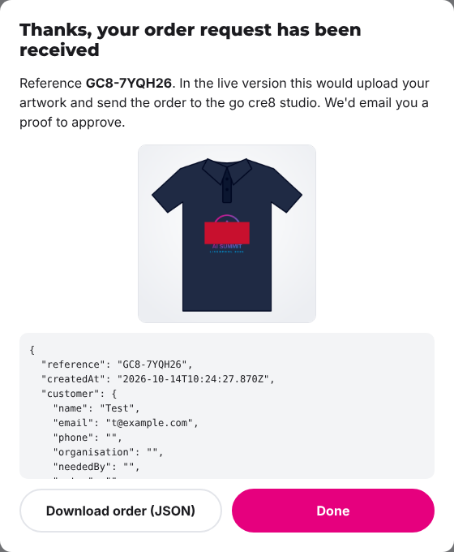

# go cre8: Design Studio (concept demo)

This is a working prototype of a **"Design your own" page** that could be added to
[gocre8.co.uk](https://www.gocre8.co.uk/portfolio-item/t-shirt-printing-clothing/), the site of the
Liverpool creative print company go cre8 (Design · Print · Display · New Media).
Customers can upload their artwork, see it on a garment, choose sizes and get a price
straight away, without having to email back and forth for a quote.

It was built as part of an offer to go cre8: a website upgrade in exchange for
printing for an AI summit. It uses go cre8's name, a CMYK-inspired colour scheme that suits a
creative printer, and copy based on their services (short-run T-shirts, polos, hoodies, workwear
and bags, with in-house graphic designers).

> The brand colours and logo here are a placeholder wordmark, not go cre8's official artwork. Swap
> in their real logo and colours with the CSS variables at the top of `css/styles.css`.

> All prices, products and options are **example data** and easy to change in one place
> (the top of `js/app.js`). The demo takes no real orders.



| Mobile preview | Order request |
| --- | --- |
|  |  |

## What it does

| Feature | Why it helps the shop |
| --- | --- |
| **Upload artwork** (drag & drop, PNG/JPG/SVG/WEBP) | Customers send print-ready files up front |
| **Live preview** on a T-shirt, polo, hoodie, sweatshirt or tote, in 8 colours, front and back | Fewer "what will it look like?" emails |
| **Drag, resize and rotate** the design inside the print area | Placement is agreed before the proof |
| **Add text** (5 fonts, any colour), e.g. "AI SUMMIT 2026" | Covers simple event and staff shirts without artwork |
| **Automatic resolution (DPI) check** | Warns customers about blurry images before they order |
| **Print method choice**: DTG, screen, vinyl, embroidery, with minimums enforced | Screen-print orders are only accepted at 20+ items |
| **Size and quantity grid** with plus-size surcharge and bulk discounts | An accurate quote straight away, 24/7 |
| **Artwork help add-on** (+£25) | Sells go cre8's in-house design service alongside the print |
| **Standard / Express / Rush turnaround** and studio collection or UK courier | Customers set their own deadline, and faster jobs carry a premium |
| **Download mockup PNG** | Customers can share the design with their team for sign-off |
| **Order request** with a structured order record (JSON) and mockup | Gives the print team everything they need in one place |

## Try it

It's a static site with no build step:

```bash
# any static server works
python3 -m http.server 8000
# open http://localhost:8000
```

Click **"Try a sample design"** to load an example AI Summit design and quantities
straight away.

To host it for free, use **GitHub Pages**: Settings → Pages → Deploy from branch → `main` / root.

## Files

```
index.html      page markup (hero, studio, quote, order form, how it works, FAQ)
css/styles.css  styling (responsive, mobile-first friendly)
js/app.js       studio logic: catalogue, preview, drag/resize, DPI check, pricing, mockup export
```

## Going live: suggested next steps

1. **Real prices and stock.** Replace the `PRODUCTS`, `METHODS` and `DISCOUNTS` objects with the shop's
   price list, or load them from the shop's back end.
2. **Receive orders.** The form currently shows a confirmation. Connect it to one of:
   - WooCommerce / Shopify: add the design and mockup to the basket as product meta
   - a simple form backend (e.g. Formspree, Netlify Forms) that emails the artwork, mockup and order JSON
   - a small API that stores files in S3 / Cloudinary
3. **Payment.** Take a deposit or full payment with Stripe after the customer approves the proof.
4. **Extras.** Names and numbers per shirt, a clip-art and font library, background removal,
   and saved designs for repeat customers.
